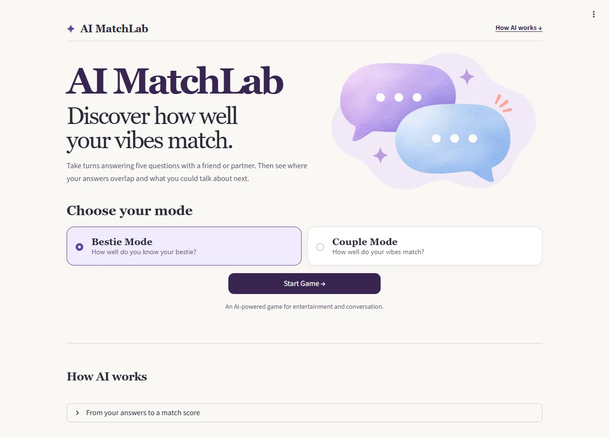
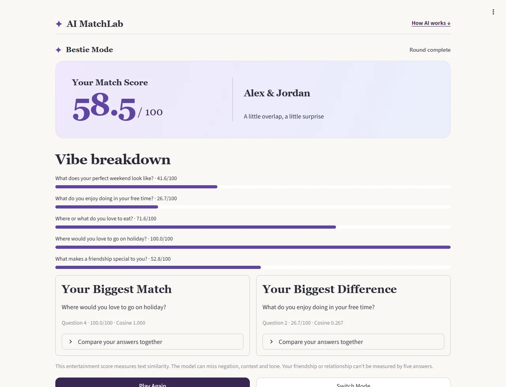

# AI MatchLab

**Discover how well your vibes match.**

[Play AI MatchLab on Streamlit Community Cloud](https://btyj2005-nlp-transformer-mini-project-app-d2788k.streamlit.app/)

AI MatchLab is a two-player Streamlit game and student portfolio project. Friends or partners take turns answering five open-ended questions, then see how closely a pretrained language model groups their answers.



## Play a round

- **Bestie Mode** asks about weekends, interests, food, holidays and friendship.
- **Couple Mode** asks about dates, time together, appreciation, holidays and relationship values.
- Each player answers privately on the same device. A handoff screen keeps the outgoing player’s answers out of view. Both players can revisit and edit their own answers before comparing.
- The results show all five scores and the questions with the highest and lowest cosine values. Open a highlight together to read the two answers side by side.
- **About** explains NLP, Transformers, BERT and the MiniLM model behind the game. The AI MatchLab header button returns home, where you can resume a round with your draft intact.
- The question card stays visible as you move through the round, and the progress bar updates in a single step.



## From the NVIDIA course to the app

I built this mini-project after completing NVIDIA Deep Learning Institute’s *Building Transformer-Based Natural Language Processing Applications* certification. The course introduced text representations, embeddings, attention and BERT, and showed how tokenization and inference fit into a deployment pipeline. I applied those ideas to a small CPU-hosted game. Sentence Transformers, MiniLM and the game’s scoring formula are practical extensions I chose for this project.

## Model and scoring

The app uses a compact, 6-layer English sentence encoder. Sentence Transformers and PyTorch tokenize each answer, run the pretrained Transformer, and pool token representations into a 384-number embedding. The app uses the same model revision and settings for both players. It runs inference on CPU without updating the weights. Answers are capped at 240 characters for quick rounds. The encoder can read up to 256 word pieces per answer. [all-MiniLM-L6-v2 model card](https://huggingface.co/sentence-transformers/all-MiniLM-L6-v2)

For each question, the app finds the cosine similarity `c` between the two embeddings by dividing their dot product by the product of their lengths. The displayed game score is `100 × max(0, c)`, with `c` bounded to `[-1, 1]` for floating-point safety. Each question has equal weight. The overall score is the arithmetic mean of the five unrounded game scores, displayed to one decimal place. The highlights use raw cosine, including negative values. Ties use the first matching question.

For example, *I enjoy watching movies at home* and *I love relaxing with films on weekends* can produce embeddings that point in similar directions. Both refer to watching films as a way to unwind. Negated answers like *I love camping* and *I hate camping* can also score highly because they share a topic. Slang, very short answers, sarcasm and text outside the model’s English training focus can affect the result. Treat the 0–100 score as a conversation starter about these answers. It has no statistical validation as a measure of relationship compatibility.

**Privacy.** Names, answers and results use Streamlit’s session state. Inference runs in the app server process. The app has no database and does not log or persist answers or send them to Hugging Face. Hugging Face supplies the model and tokenizer files. A new round clears answers and scores. Use nicknames if you prefer, and keep both players’ consent in mind when opening highlights or sharing screenshots.

## Run locally

Use Python 3.11 on Windows or Linux x86-64, or on macOS with Apple Silicon. Run these commands from the project root, after activating the virtual environment.

```bash
python -m venv .venv
# Windows PowerShell: .venv\Scripts\Activate.ps1
# macOS/Linux shell: source .venv/bin/activate
python -m pip install -r requirements.txt
python -m streamlit run app.py
```

The first scoring request downloads about 91 MB of model weights plus tokenizer files. The welcome and question screens open before the model loads. Later rounds reuse the model in memory. The CPU encoder uses small batches and a single inference thread to keep resource use down.

## Tests

```bash
python -m pip install pytest==8.4.2
python -m pytest -q
```

The default tests cover the scoring math, invalid input, both modes, editing and inference-error recovery. Enable the real-model test with `MATCHLAB_TEST_MODEL=1` and rerun pytest. In PowerShell, set it with `$env:MATCHLAB_TEST_MODEL = '1'`. The real-model test checks repeatability and compares related and unrelated English answers.

## Deploy on Streamlit Community Cloud

In [Streamlit Community Cloud](https://share.streamlit.io/), choose **Create app**, select `btyj2005/NLP-Transformer-Mini-Project`, branch `main`, and main file `app.py`. Choose Python **3.11** in **Advanced settings** and deploy. The app requires no secrets. After launch, play a full round to exercise the first model download and a second round to check reuse. Cloud start-up time and memory depend on the hosting instance. [Deployment guide](https://docs.streamlit.io/deploy/streamlit-community-cloud/deploy-your-app/deploy)

## What I learned

- Comparing embeddings helps find related ideas even when there are few shared words.
- A high similarity score can reflect a shared topic, even when the two answers disagree.
- Loading the model once and reusing it makes a small CPU app more practical.
- A clear handoff screen and saved drafts matter as much to the game as the model does.

## Author and license

**Bryan Tock**, Diploma in Applied AI & Analytics, Republic Polytechnic, Singapore.

The original project code uses MIT. The MiniLM model, Sentence Transformers, Transformers, and Streamlit use Apache 2.0. PyTorch uses a BSD-style license. These projects retain their own licenses. The hero illustration was generated for this project. [Project license](LICENSE) · [MiniLM model card](https://huggingface.co/sentence-transformers/all-MiniLM-L6-v2) · [Sentence Transformers](https://github.com/huggingface/sentence-transformers/blob/main/LICENSE) · [Transformers](https://github.com/huggingface/transformers/blob/main/LICENSE) · [Streamlit](https://github.com/streamlit/streamlit/blob/develop/LICENSE) · [PyTorch](https://github.com/pytorch/pytorch/blob/main/LICENSE)
